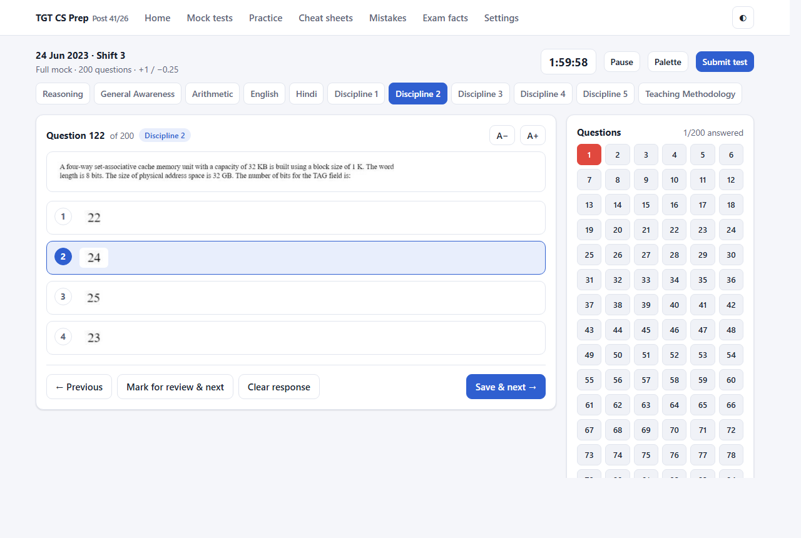
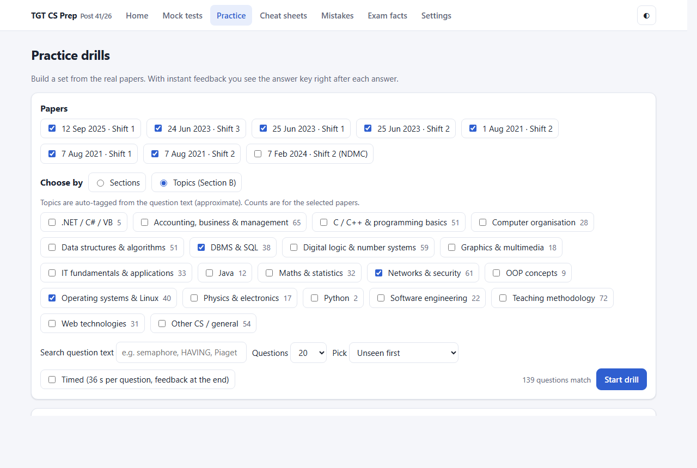
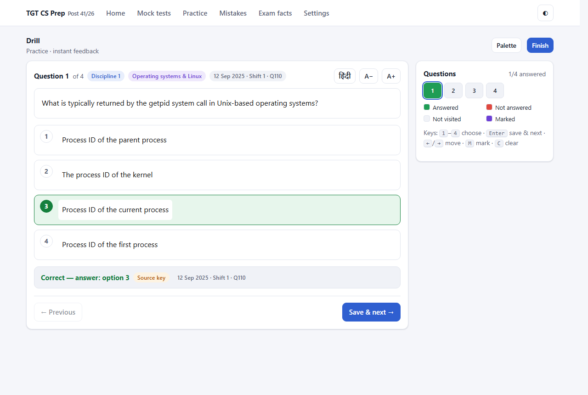
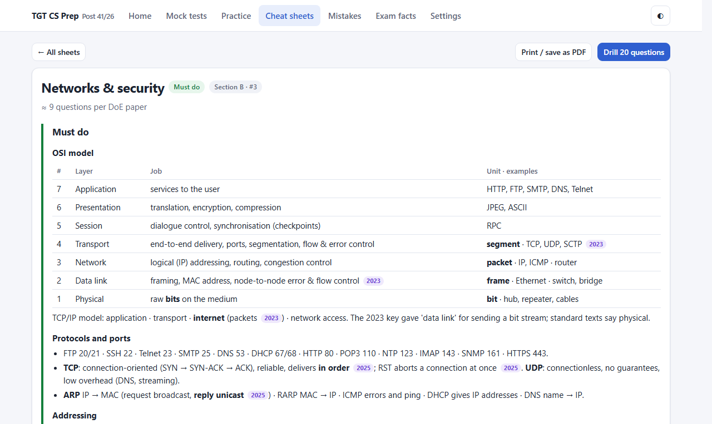

# DSSSB TGT Computer Science: real PYQ practice

A free practice platform for the **DSSSB TGT Computer Science** exam (Post Code **41/26**, Advt. **03/2026**). It is built **only from real previous-year papers**: 1,578 unique questions from 8 actual DSSSB shifts, with full timed mocks, topic drills, a mistakes notebook, an explanation for every question, 21 ranked cheat sheets, and hand-picked videos and notes for every topic. There's no sign-up, and it works offline.

### ▶ **Live site: https://aafaque2.github.io/dsssb-tgt-cs-prep/**



## Why

Many TGT CS "PYQ" collections are re-typed with errors, attributed to the wrong shift, or partly invented. Here every question comes from an actual DSSSB TGT Computer Science paper. For four of the papers, the answer key is read directly from DSSSB's own response sheet.

## Features

- **Full mock tests**
  - Exam-style setup: 200 questions, 120 minutes, +1 / −0.25 marking, in the paper's original section order.
  - CBT-style question palette with four states (answered, not answered, marked, answered & marked) and section tabs.
  - Pause, and auto-submit when time runs out.
  - A test in progress survives a page reload.
- **Result analysis**
  - Score and time for each section, plus Section A and Section B totals.
  - Qualifying check from Advt. 03/2026: 40 / 35 / 30 % applied to Section B *and* to the total.
  - Comparison with the last Directorate of Education cut-off.
- **Practice drills**: pick questions by section, by Section B topic (auto-tagged) or by search term, with instant feedback or a timer. "Unseen first" and "wrong before" modes are available.
- **An explanation for every question** (all 1,600), written for this site. Explanations appear in drill feedback and in mock reviews.
  - The answer shown is always the paper's key: DSSSB's official key, or the source's key for the transcribed papers.
  - When an explanation argues that the key is wrong or ambiguous, it is flagged **key disputed ⚠** and gives the correct working.
  - 32 questions are flagged: 18 in the official-key papers and 14 in the transcribed ones.
- **Cheat sheets: 21 of them, ranked by importance.**
  - The 16 Section B sheets are ordered by how many questions each topic had per paper in the seven DoE papers; the top 8 are *Must do*, the rest *If time permits*.
  - The 5 Section A sheets cover the general sections.
  - Each sheet has three parts: **Must do** (core facts, tables, formulas), **Most probable questions** (the question types that keep coming back) and **If time permits**.
  - Purple year tags mark facts that were actually asked in that year's paper.
  - Every sheet has a one-click drill of its questions, and sheets print cleanly (one per page) or save as PDF.
- **Study resources for every topic**: about 290 hand-picked videos, notes and books, with the most useful for this exam first.
  - Each topic page opens with **Start here** picks, then **PYQ practice**, **one-shots** and **classes** made for DSSSB TGT CS (or a close teacher exam).
  - General courses, notes and textbooks for learning a topic properly are folded under **Go deeper**: one-shots, quick revision and complete study, including free IGNOU and NCERT course books.
  - Separate tabs list **solved papers** (real DSSSB TGT CS papers worked through; those on this site link to their mock), **final-week series** and **full DSSSB courses**. A search box covers every link.
  - Each topic links its cheat sheet and a 20-question drill.
  - All 349 links were checked on 20 Nov 2026: each video was public and playable, and the lengths and video counts are as YouTube showed them that day.
- **History** keeps every mock and drill you take.
  - Reopen any result exactly as it looked when you submitted.
  - Review your answers with the exam's question palette and section tabs. The palette shows right, wrong, not answered and marked.
  - Resume unfinished tests, or delete attempts one at a time or in bulk. When deleting, you can also remove their answers from your accuracy stats.
  - History stays intact with the site open in several tabs.
- **Mistakes notebook** lists every question you last got wrong, ready to re-attempt.
- **Day-by-day plan** up to the exam date you set.
- **Verified exam facts**: vacancies, pattern, qualifying rules, tie-breaks, dates, with sources.
- **Comfort features**: keyboard shortcuts (`1`–`4`, `Enter`, `←`/`→`, `M`, `C`), dark mode, mobile layout, and a Hindi toggle for the transcribed papers.

| Practice by topic | Instant feedback with explanation |
|---|---|
|  |  |



## Question bank: 1,578 unique questions

| Paper | Post code | Department | Format | Answer key |
|---|---|---|---|---|
| 12 Sep 2025 · Shift 1 | 56/24 | Directorate of Education | Text (transcribed) | Source key |
| 24 Jun 2023 · Shift 3 | 39/22 | Directorate of Education | Original crops | **Official ✓** |
| 25 Jun 2023 · Shift 1 | 39/22 | Directorate of Education | Original crops | **Official ✓** |
| 25 Jun 2023 · Shift 2 | 39/22 | Directorate of Education | Original crops | **Official ✓** |
| 1 Aug 2021 · Shift 2 | 91/20 | Directorate of Education | Text (transcribed) | Source key, cross-checked |
| 7 Aug 2021 · Shift 1 | 91/20 | Directorate of Education | Text (transcribed) | Source key |
| 7 Aug 2021 · Shift 2 | 91/20 | Directorate of Education | Text (transcribed) | Source key |
| 7 Feb 2024 · Shift 2 | 70/23 | NDMC | Original crops | **Official ✓** |

Post 41/26 is a Directorate of Education post, so those papers come first. The 2024 paper was for NDMC, which uses a CBSE-style syllabus. Its Section A is the same style, though.

The 8 papers have 1,600 question slots but 1,578 unique questions:
- **7 Aug 2021 · Shift 2, English (Q61–80).** The source's English section is a copy of 1 Aug 2021 · Shift 2's, question for question, and the official 1 Aug response sheet confirms those questions belong to 1 Aug. That shift's real English section isn't available. Its mock therefore shows the 1 Aug questions, clearly labelled, so it stays a full 200-question test.
- **Two Section B questions** in that paper (Q117, Q118) are also identical to 1 Aug 2021 · Shift 2 Q160 and Q159. DSSSB does reuse questions within an exam cycle, so these stay in the mock.
- Copies are left out of drills and counts, so you never practise the same question twice.

### How the answer keys were obtained

- **Response-sheet papers (official ✓).**
  - DSSSB response sheets print a green ✓ next to the correct option and a red ✗ next to the others. The extractor reads those icons straight from the PDF, so every question has exactly one ✓. Hand spot-checks matched.
  - The crops shown in the app have the icons, option labels, Question-ID box and watermark removed.
  - The red/green colouring of option text is normalised to black, so nothing on screen gives the answer away.
- **Transcribed papers (source key).**
  - Keys are as published by the transcription source.
  - For 1 Aug 2021, the source's keys were compared with the official response-sheet key and matched in all 71 questions that could be compared.

### What Section B actually asks (7 Directorate of Education papers, 698 unique questions, auto-tagged)

| Topic | Share | | Topic | Share |
|---|---|---|---|---|
| Teaching methodology | 10% | | Operating systems & Linux | 6% |
| Accounting, business & management | 9% | | DBMS & SQL | 5% |
| Networks & security | 9% | | IT fundamentals & applications | 5% |
| Digital logic & number systems | 8% | | Maths & statistics | 5% |
| C / C++ & programming basics | 7% | | Web technologies | 4% |
| Data structures & algorithms | 7% | | Computer organisation | 4% |

About 8% of questions fit no single topic. Software engineering, graphics, physics/electronics, Java, OOP and .NET make up the rest. Python appears in only 2 of these 698 questions.

## Exam at a glance (Post 41/26)

| Item | Details |
|---|---|
| Vacancies | 675: UR 416 · EWS 116 · SC 104 · ST 39 · OBC 0 (PwBD 22, horizontal) |
| Pay | Level 7 |
| CBT dates | 27, 28, 30 Nov and 1–4 Dec 2026, in three shifts |
| Pattern | One tier, 200 MCQs, 2 hours, +1 / −0.25 |
| Section A (100) | GA, Reasoning, Arithmetic, Hindi, English, 20 each |
| Section B (100) | Computer Science, including teaching methodology |
| Minimum marks | General/EWS 40 %, OBC (Delhi) 35 %, SC/ST/PwBD 30 %. They apply to Section B **and** the total; Section A has no minimum. |
| Ties | Higher Section B marks win, then the older candidate |

Always confirm details on **[dsssb.delhi.gov.in](https://dsssb.delhi.gov.in)**.

## Use it offline

Download the repository (**Code → Download ZIP**), unzip it and open `docs/index.html` in Chrome or Edge.

## Privacy

There are no accounts, cookies, analytics or third-party requests: the site is plain static files. Your progress is stored only in your own browser (`localStorage`). Clearing site data erases it, so use **Settings → Export backup** now and then.

## Known limitations

- Transcribed papers can contain transcription slips (e.g. a missing `#include` header or a missing comma in code). They are labelled **Source key**.
  - The reading-comprehension passages (English Q76–80, Hindi Q96–100) and lost underlines have been restored from the source pages.
  - 6 questions whose source is incomplete or damaged carry a note above the question: 12 Sep 2025 Q175 and Q177; 1 Aug 2021 Q60; 7 Aug 2021 Shift 1 Q137; 7 Aug 2021 Shift 2 Q15 and Q52.
- Topic tags come from keyword rules on the question text and are approximate.
- Cheat-sheet rankings come from the auto-tagged topic counts, so they are a guide, not a guarantee of what will be asked.
- Not included yet: 24 Jun 2023 Shift 2, 12 Sep 2025 Shifts 2–3, 13 Sep 2025 Shift 3, and the 2017 paper.

## Project structure

```
docs/                 the website (served by GitHub Pages from /docs)
  index.html          the whole app: HTML + CSS + vanilla JS, no dependencies
  data/papers.js      questions, answer keys, sections, topics, explanations
  data/sheets-*.js    the cheat sheets (Section B must-do, Section B if-time-permits, Section A)
  data/resources.js   study resources for each topic: videos, notes and books
  img/<paper>/        question and option crops, formula images
screenshots/          images used in this README
```

## Found a wrong key or a broken question?

Please [open an issue](https://github.com/aafaque2/dsssb-tgt-cs-prep/issues). Include the paper, the question number shown in the app (e.g. *12 Sep 2025 · Shift 1 · Q110*) and what's wrong.

## Disclaimer

This is an independent, non-commercial study aid. It is **not affiliated with DSSSB** or the Government of NCT of Delhi. The questions belong to DSSSB and are reproduced here for exam practice.

- The response-sheet papers were taken from freely available PDF copies published by Adda247.
- The transcribed papers come from yourmocktest.com (questions and answer keys only).

If you hold rights to any of this material and want it removed, please open an issue.
